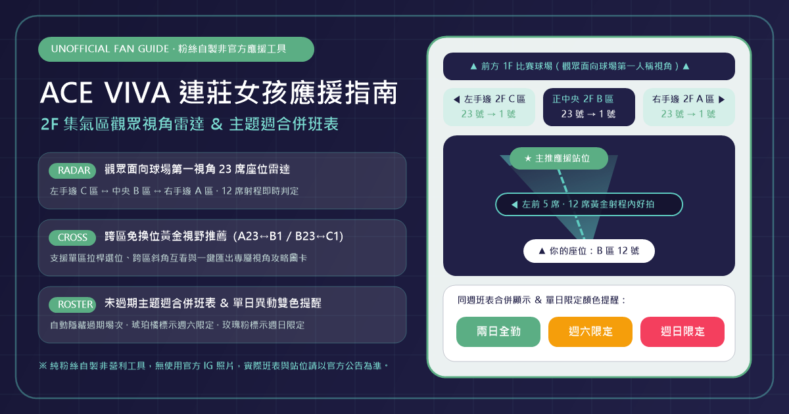

# ACE VIVA 連莊女孩應援指南（粉絲自製非官方網站）



本專案為支持台灣職業排球聯盟（TPVL）臺中連莊職業排球隊及其專屬啦啦隊「ACE VIVA（連莊女孩）」之球迷粉絲獨立開發的**非官方、非營利應援查詢工具**。旨在協助進場球迷快速查詢 18 位成員圖鑑、2F 集氣區（A、B、C 區 1 至 23 號席）觀眾第一視角座位雷達、跨區免換位黃金視野（如 A 區大號看 B 區小號），以及未過期主題週合併班表與單日異動提醒。

---

## 一、 粉絲自製頁面免責聲明（Fan-Made Disclaimer）

> [!IMPORTANT]
> **非官方網站聲明**：本網站與專案原始碼均由球迷粉絲自發整理與維護，**並非**臺中連莊職業排球隊（Win+Streak Volleyball Club）、LEXX 原質娛樂或 ACE VIVA（連莊女孩）之官方網站，與上述球團、經紀公司及成員個人均無任何官方委任、贊助、合作或商業從屬關係。

### 1. 網站性質與非營利原則
* 本專案純屬球迷間無償分享之非營利應援輔助工具，全站無任何商業收費、廣告營利或售票行為。

### 2. 賽程、出席班表與座位視角推算免責
* 站內所列之主場主題週日期、出席成員名單、2F ACE 集氣區（A 區、B 區、C 區）各局站位、主隊得分破 10 分換位規則、1 至 23 號座位視角對應及 12 席正面拍攝射程推算，均係依據官方公開貼文所作之幾何輔助推算。
* 體育館現場實際座椅排列、欄杆動線、舞台站位或成員臨時排班異動，**請一律以臺中連莊球團與 ACE VIVA 官方社群最新實際公告及現場工作人員指引為準**，本站不負擔保資料即時正確性之責任。

### 3. 著作權、肖像權歸屬與社群預覽圖無版權疑慮設計
* **權利歸屬**：站內成員圖鑑所引用之成員姓名、背號、公開資歷與形象照片，其著作權、商標權與肖像權均歸屬臺中連莊職業排球隊、LEXX 原質娛樂及各成員本人所有，本站僅於合理範圍內作非營利應援推廣與資訊索引使用。
* **原創圖示與社群連結預覽圖去官方化**：為避免商標混淆與社群連結預覽版權疑慮，本網站之**網頁主圖示（Favicon / App Icon）**與**社群連結預覽圖（Open Graph `og-preview.png`）**均採用 100% 原創幾何向量設計，不包含任何官方 Instagram 照片或官方隊徽。
* **權益通知與移除機制**：若官方球團、經紀公司或成員認為本站任何內容有不妥之處，請隨時透過 GitHub Issue 提出，維護者將於收到通知後立即配合修正或下架。

---

## 二、 連線方式說明（Connection & Access Guide）

本專案支援以下 4 種連線與瀏覽方式，使用者可依使用情境選擇：

### 1. 線上正式站台連線（推薦，免安裝直接使用）
本專案已部署於 GitHub Pages，可直接透過手機、平板或電腦瀏覽器連線使用：
* **正式連線網址**：https://mouse170.github.io/ace_viva_schedule/
* **手機加入主畫面（Web App 模式）**：
  * **iOS（Safari）**：開啟上述網址 -> 點擊底部「分享」按鈕 -> 選擇「加入主畫面」，即可於桌面建立原創應援雷達圖示捷徑。
  * **Android（Chrome）**：開啟上述網址 -> 點擊右上角選單 -> 選擇「加到主畫面」或「安裝應用程式」。

### 2. 本機開發環境連線（Localhost 開發模式）
若需於個人電腦修改程式碼或即時預覽變更，請確認已安裝 Node.js（建議 v20 以上），並依序執行以下指令：

```bash
# 1. 複製專案儲存庫並進入目錄
git clone https://github.com/mouse170/ace_viva_schedule.git
cd ace_viva_schedule

# 2. 安裝相依套件
npm install

# 3. 啟動 Vite 本機開發伺服器
npm run dev
```

啟動後，開啟電腦瀏覽器連線至：
* **本機連線位址**：`http://localhost:5173/`（或 `http://localhost:5173/ace_viva_schedule/`）

### 3. 區網手機實機測試連線（LAN Wi-Fi 跨裝置連線）
若開發者欲在手機實機（如 Samsung Galaxy S25、iPhone 等）測試觸控拉桿與手機三欄圖鑑排版，可將手機與電腦連上同一個 Wi-Fi 區域網路，並執行：

```bash
npx vite --host
```

終端機將輸出 Network 區網連線位址（例如 `http://192.168.1.xxx:5173/`），直接於手機瀏覽器輸入該區網網址即可即時連線測試。

### 4. 正式版打包與本機預覽連線（Production Build & Preview）
欲於部署前驗證正式環境打包結果（含 TypeScript 型別檢查與靜態資源壓縮），請執行：

```bash
# 1. 編譯 TypeScript 並產出 dist/ 正式版靜態檔案
npm run build

# 2. 啟動本機正式版預覽伺服器
npm run preview
```

啟動後可透過 `http://localhost:4173/ace_viva_schedule/` 連線檢視正式打包成果。

---

## 三、 核心功能模組（Core Features）

1. **全體成員應援圖鑑（智慧優先排序 ＆ 手機高密度三欄版型）**
   * **智慧排序**：自動依「**1. 我的主推成員** -> **2. 自己座位正前方女孩** -> **3. 其餘成員**」順序排列，支援於圖鑑上方即時切換目前座位（如 `2F B 區 12 號`）。
   * **手機三欄排版**：針對手機螢幕（如 Galaxy S25）最佳化，單一畫面可同時顯示 **6 至 9 位成員**，並提供「複製名」與「複製 `@IG`」一鍵複製按鈕、當月壽星高亮提醒與原創星座圖示。
2. **以女孩為主的 2F 選位攻略（支援跨區免換位黃金視野）**
   * 依據官方各局站位表，自動推算主推女孩於第 1、4 局、第 2、5 局與第 3 局之首選應援區，並提供 **A23 接 B1（坐 A 區大號看 B 區小號）** 與 **B23 接 C1（坐 B 區大號看 C 區小號）** 跨區免換位黃金席位推薦。
3. **2F 集氣區 23 席直線拉桿查詢 ＆ 觀眾第一視角座位雷達**
   * 採用**觀眾面向球場第一人稱視角**（左手邊為 `C 區 23 號`，中央為 `B 區`，右手邊為 `A 區 1 號`，視線往上 `▲` 看向應援舞台與 1F 球場）。
   * 內建第 1、4 局／第 2、5 局／第 3 局與「開局 0 至 10 分／破 10 分換位後」快速切換按鈕，當主推距離在 **12 個座位以內** 時標示為黃金正面拍攝射程，超過 12 席則提示角度過斜可能拍不到正面。
4. **雙模式主推視角攻略圖卡產生器（Canvas 高解析 PNG 匯出）**
   * **模式 1（固定座位版）**：鎖定已選座位（如 `B 區 12 號`），繪製全場各局主推相對方位雷達與正前方女孩一覽圖。
   * **模式 2（局間換位 ＆ 跨區版）**：推薦每局最佳換位區間，並附跨區互看指引（如坐 A 區大號可看 B 區小號）。
5. **主題週合併應援班表（自動隱藏過期主題日 ＆ 單日異動雙色提醒）**
   * 自動過濾已過期之主題週賽事，並將同一主題週（週六、週日）班表合併呈現：兩日全勤成員以**翡翠綠**標示，週六限定成員以**琥珀橘**高亮提醒，週日限定成員以**玫瑰粉**高亮提醒。

---

## 四、 官方資訊查證管道（Official Channels）

購票選位前或進場應援當日，請務必前往以下官方管道確認最新公告：
* **ACE VIVA 連莊女孩官方 Instagram**：[@ace_viva_official](https://www.instagram.com/ace_viva_official/)
* **臺中連莊職業排球隊官方 Instagram**：[@winstreakvolleyball](https://www.instagram.com/winstreakvolleyball/)
* **LEXX 原質娛樂官方 Instagram**：[@lexx.ent_official](https://www.instagram.com/lexx.ent_official/)
* **維基百科條目**：[Ace Viva — 維基百科](https://zh.wikipedia.org/zh-tw/Ace_Viva)
